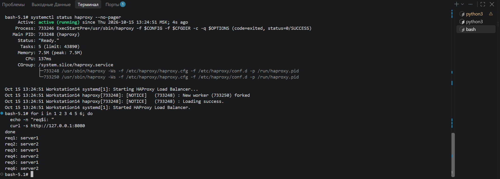
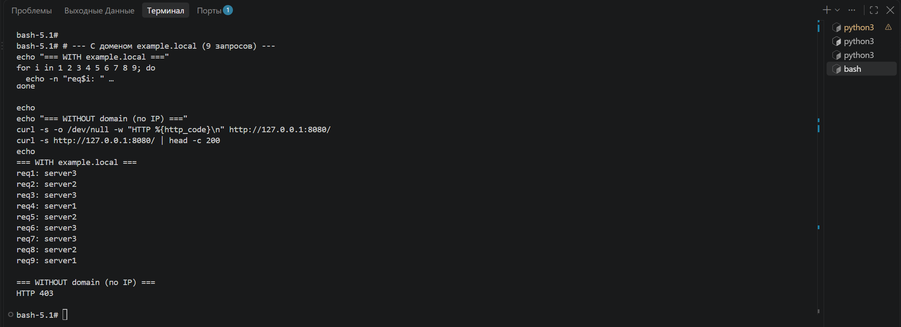

# Домашнее задание к занятию "Балансировка нагрузки / HAProxy" - Дорофеев Максим
### Инструкция по выполнению домашнего задания
Решение выполнено на Rocky Linux 9 (WSL). Репозиторий: https://github.com/workstation14gig-ux/hw-haproxy
---
### Задание 1
Запущены два simple Python HTTP-сервера на портах `8001` и `8002`.  
Установлен HAProxy 2.8. Настроена балансировка **Round-robin** на **4 уровне** (`mode tcp`).  
Клиенты обращаются на порт `8080`, бэкенды — `127.0.0.1:8001` и `127.0.0.1:8002`.
Конфигурация: [haproxy-task1.cfg](haproxy-task1.cfg)
Проверка (чередование server1 / server2):

---
### Задание 2
Запущены три Python-сервера на портах `8001`, `8002`, `8003`.  
Настроена балансировка **Weighted Round Robin** на **7 уровне** (`mode http`):
- server1 — weight **2**
- server2 — weight **3**
- server3 — weight **4**
HAProxy балансирует только HTTP-трафик с Host `example.local` (ACL по заголовку Host).  
Запросы без этого домена получают **HTTP 403**.
Конфигурация: [haproxy-task2.cfg](haproxy-task2.cfg)
Проверка: с доменом `example.local` (видны веса) и без домена (403):

---
